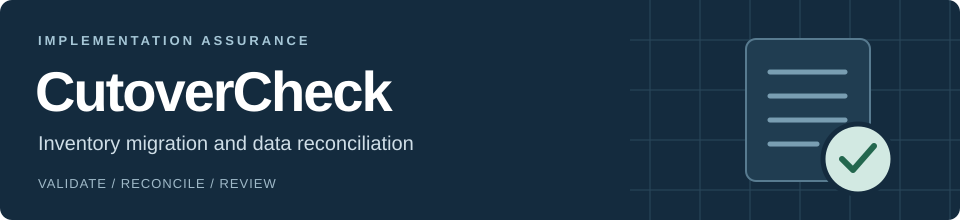
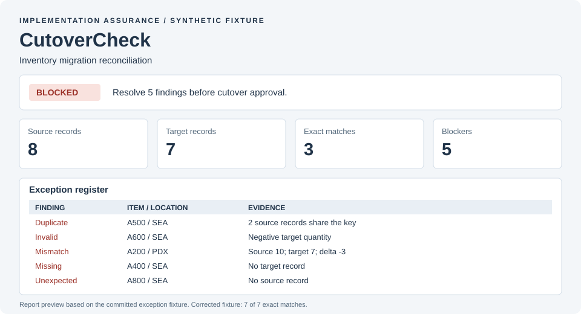
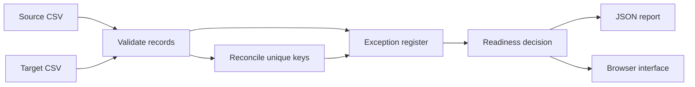

<p align="center">
  
</p>

<p align="center">
  <b>Inventory migration reconciliation for ERP and enterprise SaaS implementations.</b>
</p>

<p align="center">
  
  
  
  
</p>

<p align="center">
  <a href="reports/blocked.md">Sample report</a> &nbsp; | &nbsp;
  <a href="reports/ready.md">Corrected migration</a> &nbsp; | &nbsp;
  <a href="docs/implementation.md">Case study</a> &nbsp; | &nbsp;
  <a href="demo.html">Browser demo</a>
</p>

## Overview

CutoverCheck compares legacy and target inventory exports before a system cutover. Matching record counts alone cannot establish that a migration is correct: duplicate item/location keys, missing stock, invalid values and quantity variances can still disrupt operations.

The tool produces a deterministic readiness decision and an exception register with record-level evidence. It runs locally, requires no credentials, and does not modify either system.



## Demonstration

| Migration scenario | Result | Evidence |
|---|---|---|
| Seeded exceptions | **BLOCKED** | [Five blocking findings](reports/blocked.md) |
| Corrected dataset | **READY** | [Seven exact matches](reports/ready.md) |

Both scenarios use committed synthetic fixtures. The first run identifies a duplicate key, invalid quantity, missing record, unexpected record and quantity mismatch. After correction, all seven item/location balances reconcile exactly.

**Start here:** The reports and [implementation case study](docs/implementation.md) can be read directly on GitHub without installing software.

## Capabilities

| Area | Implementation |
|---|---|
| Data quality | Required fields, integer quantity validation, composite-key uniqueness |
| Reconciliation | Missing and unexpected records, quantity differences, configurable tolerance |
| Implementation assurance | Readiness decision, exception ownership, UAT acceptance criteria |
| SQL analytics | Staging constraints, CTEs, joins, warehouse summaries, window-function ranking |
| Interfaces | Standalone browser demo and CLI with JSON export |
| Verification | Regression tests, SQL checks, report reproducibility and CI configuration |

## Architecture



The engine uses indexed composite-key comparisons with expected linear time and space complexity. The [SQL companion](sql/reconciliation.sql) independently analyzes validated staging data. See [design decisions](docs/design.md) for tradeoffs and scope.

## Quick start

### Browser

Open [demo.html](demo.html) on GitHub and use the download option. Open the downloaded file in a browser. The sample scenarios are embedded and the demo also accepts local CSV files. No server, dependencies or credentials are needed.

### Command line

Requires Node.js 22 or later. From a local copy of the repository:

```sh
node src/cli.mjs fixtures/source.csv fixtures/target.csv
node src/cli.mjs fixtures/clean.csv fixtures/clean.csv
npm test
```

| Exit code | Meaning |
|---:|---|
| 0 | READY |
| 1 | Input or usage error |
| 2 | BLOCKED |

Redirect stdout to save a JSON report. An optional third positional argument specifies quantity tolerance in units (default: 0).

## Input contract

```csv
sku,warehouse,quantity
A100,PDX,25
A200,SEA,10
```

Column order may vary. SKU and warehouse are case-sensitive after trimming whitespace. Their combination is the business key. Quantities must be nonnegative integers up to 1 billion. Quoted fields, escaped quotes and CRLF are supported. Blank lines are ignored; delimiter-only records are invalid. Findings use logical nonblank record numbers including the header. Input is capped at 100,000 data records per file; the CLI and browser file picker cap files at 10 MB.

## Decision rules

| Finding | Condition |
|---|---|
| Invalid | Missing key, malformed quantity or wrong column count |
| Duplicate | Multiple valid records share a key on either side |
| Missing | Unique source key absent from target |
| Unexpected | Unique target key absent from source |
| Mismatch | Absolute quantity difference exceeds tolerance |
| Empty | Either dataset contains no data records |

Invalid or duplicate keys are excluded from cross-file comparisons to avoid misleading secondary findings. Any finding blocks readiness. Within-tolerance differences are counted separately from exact matches.

## Repository guide

| Location | Purpose |
|---|---|
| [src/](src/) | Reconciliation engine and command-line interface |
| [demo.html](demo.html) | Standalone browser interface |
| [fixtures/](fixtures/) | Repeatable synthetic migration exports |
| [reports/](reports/) | Example Markdown and JSON results |
| [sql/](sql/) | Relational reconciliation and analytics |
| [tests/](tests/) | JavaScript and SQL regression tests |
| [docs/](docs/) | Implementation notes, architecture and reviewer walkthrough |
| [.github/workflows/](.github/workflows/) | Automated validation |

## Validation

```sh
npm test
python -m unittest discover -s tests -p 'test_sql.py'
```

CI checks the regression suites, CLI exit codes, reproducibility of committed JSON reports and consistency between the browser and CLI engine. See [verification guide](docs/verification.md) for expected results.

## Scope

CutoverCheck is a self-contained implementation lab using fictional inventory data. It does not connect to commercial ERP or WMS systems. A READY decision confirms the configured checks passed; operational UAT, rollback planning, integration validation and business sign-off are separate controls.
