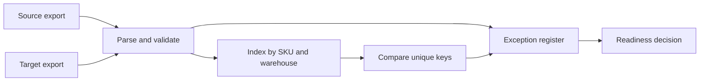

# Design notes

The system separates CSV parsing, validation, key-based reconciliation and presentation. The CLI and browser use the same engine. The SQL companion demonstrates relational analysis of clean staging data.



## Decisions

- Use a composite business key rather than comparing row order or totals. JSON serialization of the two key fields prevents delimiter collisions.
- Use integer quantities to avoid floating-point rounding ambiguity. Tolerance is explicit and defaults to zero.
- Treat duplicates and invalid records as blocking errors. A rejected key is excluded from quantity comparisons rather than arbitrarily choosing a value.
- Use maps for expected O(n + m) reconciliation time and O(n + m) memory; this is an in-memory tool with explicit size limits, not a streaming ETL service.
- Keep the demo local and dependency-free. User-entered data is rendered as text, not HTML. No server receives CSV contents.
- Keep readiness deterministic. The tool does not modify source or target systems.

## SQL companion

The SQL script defines staging constraints, an outer-join reconciliation view, warehouse-level match rates and a window-function ranking for quantity exceptions. It assumes records were validated before staging and uses exact matching. It is not a second full CSV validator.

Run the SQL checks with Python 3:

```sh
python -m unittest discover -s tests -p 'test_sql.py'
```

## Limitations

No live ERP connector, authentication, inventory movements, cross-unit conversion, audit database or production scheduler. CSV snapshots must be aligned in time. The browser runs the embedded core; the CLI is the primary automation interface. Business sign-off remains outside the scope of the tool.
